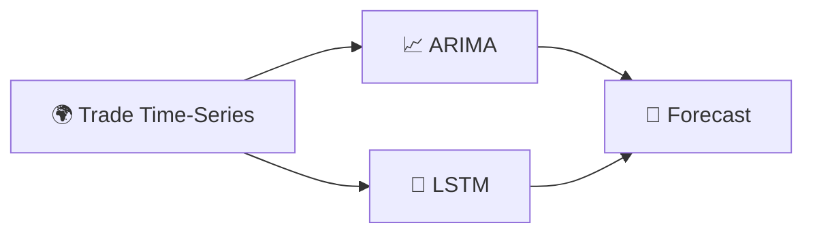

<div align="center">


<b><i>Predictive analytics for trade using ARIMA & LSTM</i></b>


     

   
</div>

---

## 🚢 About the Project

Based on *“Predictive Analytics for Export Forecasting using ARIMA and LSTM”*, this project analyses **import and export trade data of all countries** and forecasts future trade values with **ARIMA** (statistical) and **LSTM** (deep learning) time-series models, served through Flask.

## ✨ Key Features

- 🌍 Trade dataset covering **all countries**
- 📈 **ARIMA** baseline forecasting
- 🧠 **LSTM** deep-learning forecasting (`lstm_model.pkl`)
- 📊 Trend visualisation in `forcasting.ipynb`
- 📄 Abstract, base paper and full report included

## 🧠 How It Works



## 🛠️ Tech Stack

| Layer | Technology |
|---|---|
| Language | Python 3 |
| Time-series | Statsmodels (ARIMA) · TensorFlow/Keras (LSTM) |
| Data | Pandas · NumPy |
| Web | Flask |

## 📂 Project Structure

```text
├── abstract/ · basepaper/ · full document/
└── code/import export forcasting/
    ├── app.py
    ├── forcasting.ipynb
    ├── import export of all countries.csv
    └── lstm_model.pkl
```

## 🚀 Getting Started

```bash
git clone https://github.com/PreciousBharath/TRACKING-IMPORT-AND-EXPORT.git
cd "TRACKING-IMPORT-AND-EXPORT/code/import export forcasting"
pip install flask pandas numpy statsmodels tensorflow
python app.py
```

## 🤝 Contributing

Contributions, issues and feature requests are welcome! Feel free to ⭐ star the repo and open a pull request.

## 👨‍💻 Author

<div align="center">

**Bharath** — Software Developer · Project Engineer · Technical Trainer

<a href="https://github.com/PreciousBharath"></a>
<a href="https://linkedin.com/in/connectbharath"></a>

### 🍔 EAT · 😴 SLEEP · 💻 CODE · 🔁 REPEAT

⭐ **If you found this project useful, give it a star!** ⭐


</div>
